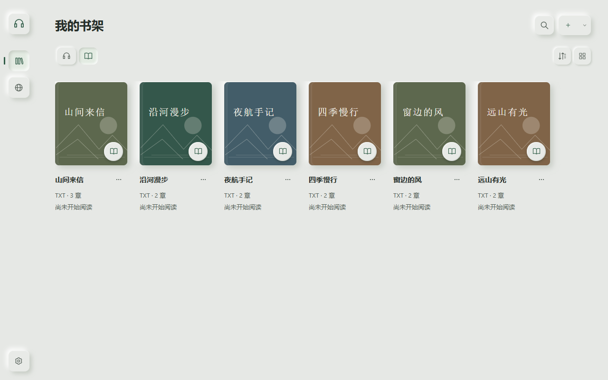
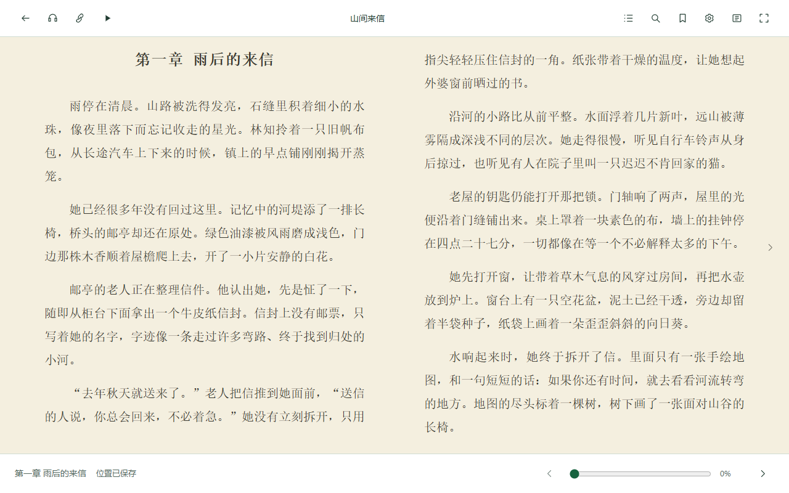

# 听见书页 · PageEcho

**在一个书架里，听有声书、读电子书、跟随声音看文字。**

面向 Windows 的桌面听读软件。保留原有演播录音，通过本地转写生成字幕；也可以独立阅读 TXT／EPUB，或使用 Windows 系统声音朗读正文。

[功能](#功能) · [开始使用](#开始使用) · [来源与插件](#来源与插件) · [本地开发](#本地开发) · [开发记录](#开发记录)

当前程序为 **Windows x64 开发预览 `0.36.0-dev.1`**。已实现的能力、验证结果和限制记录在 [CHANGELOG](CHANGELOG.md) 与 [逐版说明](docs/releases/)。



## 功能

| 能力       | 可以做什么                                                                             |
| ---------- | -------------------------------------------------------------------------------------- |
| 统一书架   | 管理有声书和电子书，保存收听／阅读位置，显示来源原封面，关联同一作品的声音与正文       |
| 日常听书   | 本地文件／文件夹导入，倍速、跳转、断点续播、自动下一集、书签、定时停止和片头片尾跳过   |
| 电子书阅读 | TXT／EPUB、目录、全文搜索、分页／连续滚动、单双栏、字体排版与独立阅读配色              |
| 同步伴读   | 字幕跟随、点击句子定位声音；关联小说原文后，在有效映射处双向切换听书与阅读             |
| 本地字幕   | 配置离线组件后边听边生成，优先处理当前收听位置；支持取消、重试、部分结果保留与人工校正 |
| 文稿工具   | SRT／WebVTT 导入导出、搜索、拆句／合句、时间校正、撤销与名称批量纠错                   |
| 来源中心   | 音频与正文搜索、原封面、多源首批结果、分章导入续读，以及个人书库连接                   |
| 数据维护   | 书架资料备份与恢复、离线准备计划、缓存管理和受管生成物保留策略                         |

应用提供浅色、深色、跟随系统，以及“极简留白／新拟态”视觉风格。阅读纸色和正文排版独立设置，切换页面保持原有音频会话。



截图使用合成书目与自编示例正文，说明见 [截图来源](docs/images/README.md)。

## 开始使用

### 使用目录版

仓库保存源码与文档，程序包和模型不随 Git 提交。可以按[本地开发](#本地开发)自行构建；已有完整程序包时，按以下方式启动。

保留完整的 Windows 程序目录，退出旧版本后再启动新版：

- `continue-preview.cmd`：沿用既有预览书架与进度。
- `start.cmd`：使用该目录版的独立数据配置。

软件原名“听读 · ReadAndListenBook”。改名后继续沿用原有书架、进度和设置的数据路径，无需手动迁移或重命名已有文件夹；命名与兼容范围见 [品牌与兼容标识](docs/BRANDING.md)。

目录版自带主程序运行环境，普通听书和阅读不需要另装 Node.js 或系统 Python。不能只复制 `runtime/electron.exe`。程序目录、ZIP 和模型属于本机构建输出，不随 Git 仓库提交；路径、校验与组件配置见 [交付说明](docs/DELIVERY.md)。

### 选择你的使用方式

| 想做什么             | 需要准备什么                                                      |
| -------------------- | ----------------------------------------------------------------- |
| 听已有录音           | 本地音频，或当前可用的在线来源；已验证格式包括 MP3、M4A、M4B、WAV |
| 阅读电子书           | 导入 TXT／EPUB，即可使用目录、搜索和阅读设置                      |
| 朗读电子书           | Windows 已安装的本地语音；正文直接作为朗读内容，无需转写模型      |
| 为录音生成字幕       | 另外配置本地离线组件，选择实际可用的识别引擎与设备                |
| 一边听一边看小说原文 | 关联对应电子书，使用字幕与有效映射定位；不确定的位置保留待校正    |

播放录音时，已有字幕直接复用；缺少字幕且自动方案可用时在后台生成，声音可以继续播放。没有组件时仍可普通听书。模型不包含在主程序中，也不会在启动时自动下载。

应用设置中的“备份与存储”可以导出阅读资料、预览恢复内容，并在确认后重启恢复。备份不包含原音频、外部原书文件、模型、缓存、凭据或插件执行包，完整范围见 [备份恢复说明](docs/BACKUP_STORAGE.md)。

## 来源与插件

来源中心把有声书、电子书、个人书库和插件分开管理。

| 类型     | 当前接入                                      |
| -------- | --------------------------------------------- |
| 音频来源 | 听十三、LibriVox，以及已启用的音频插件        |
| 正文来源 | 中文维基文库，以及已启用的正文插件            |
| 个人书库 | OPDS 1.x、WebDAV、Audiobookshelf 主电子书连接 |

音频与公共正文可选择“全部来源”，陆续查看各来源首批结果；失败来源独立显示，可取消未完成请求。来源分章正文可以追加到同一本书，保留位置，并在阅读底栏获取下一章。协议与容量边界见 [来源中心说明](docs/SOURCE_CENTER.md)。

导入插件：**来源中心 → 插件 → 导入 ZIP → 查看权限 → 确认安装**。安装后，选择对应音频／正文来源再搜索。插件支持检查、启停、手动更新和版本回滚。

插件采用本项目 **SDK v1 的 ZIP／JavaScript 格式**。脚本运行在隔离的 QuickJS 环境中，网络请求由宿主按声明的权限处理，不直接获得应用的文件系统或 Node.js 接口。它不直接兼容其他阅读器的 DLL、JAR 或脚本包。

- [SDK、清单与接口](docs/SOURCE_PLUGINS.md)
- [从网站制作插件的步骤](docs/MAKE_SOURCE_PLUGIN.md)
- [中文维基文库示例](examples/source-plugins/wikisource/)
- [bqg631 示例与适用范围](examples/source-plugins/bqg631/README.md)

从示例生成可导入包：

```powershell
npm ci
npm.cmd run plugin:pack -- --directory examples/source-plugins/wikisource --output cache/plugin-examples/wikisource-1.0.0.zip
```

输出文件须为新文件；重复打包时更换文件名。插件包只包含适配代码，不包含网站书籍。

## 本地开发

开发环境：**Windows x64、Node.js ≥24.19 且 <25、npm**。依赖版本由 `package-lock.json` 固定。本地字幕组件独立配置，不是启动界面的前置条件。

```powershell
git clone https://github.com/Yuff1010/PageEcho.git
cd PageEcho
npm ci
npm.cmd run runtime:install
npm.cmd run dev
```

检查源码并生成隔离预览：

```powershell
npm.cmd run check
New-Item -ItemType Directory -Force out | Out-Null
npm.cmd run build:preview -- --version 0.36.0-dev.1
```

全新 checkout 不包含 `out/`，上面的命令会在缺失时创建空目录，已有内容继续保留。构建会返回 `appRoot`，写入新的 `cache/managed-generated/` 目录，保留根 `out/`。把返回的实际路径用于桌面回归或自包含打包：

```powershell
$env:RALB_APP_ROOT = '<构建返回的 appRoot>'
npx.cmd playwright test
npm.cmd run pack:handoff -- --app-root '<构建返回的 appRoot>'
```

当前 `package.json` 的 `0.8.4` 保留为识别内核基线；程序预览的实际版本由 `build:preview -- --version` 指定。不要把基线号当作当前交付版本。

```text
src/
├─ main/       Electron 主进程、书库、来源、后台任务
├─ preload/    受限 IPC 桥
├─ renderer/   React 界面、阅读与播放控件
└─ shared/     数据与消息契约
python/        离线转写运行模块
examples/      来源插件示例
scripts/       构建、组件与维护工具
tests/         单元、桌面及独立验收
docs/          使用、设计、架构与版本记录
```

模块职责见 [架构说明](docs/ARCHITECTURE.md) 与 [工作区结构](docs/WORKSPACE_STRUCTURE.md)。修改界面前请阅读 [共享设计规范](docs/DESIGN_SYSTEM.md)。

## 当前边界

- 当前验证平台为 Windows x64；其他系统和架构尚未完成验收。
- 本地书籍、已缓存音频和离线组件可在无网络时使用；搜索与获取新内容依赖来源服务。
- 自动识别、原文匹配和时间对齐可能存在错误，不保证所有录音都能精确同步；人工修改与未匹配位置会保留。
- 网站接口可能变化。OPDS 暂不处理 DRM、购买或借阅；Audiobookshelf 连接暂不创建远程音频会话或同步远程进度。
- 自包含目录已做本机隔离运行验证；全新设备、安装器及模型人工质量验收仍以各版本记录为准。

## 开发记录

想了解项目从需求到交付的演进，可以按下面的顺序阅读：

[原始需求](docs/archive/initial-requirements.md) → [开发计划](docs/PLAN.md) → [技术决策](docs/DECISIONS.md) → [软件架构](docs/ARCHITECTURE.md) → [版本变更](CHANGELOG.md) → [逐版验证与交付](docs/releases/)。

早期需求与验收资料已保留，完整源码提交从 `v0.26.0-dev.3` 开始；更早阶段没有逐版源码快照。所有专题入口见 [文档导航](docs/README.md)。

## 许可

本项目源码采用 [MIT 许可证](LICENSE)，允许使用、修改和分发，分发时须保留版权与许可声明。第三方依赖、示例中的独立材料、外部书籍和模型保留各自的许可证与权利，不因本项目采用 MIT 而改变；见 [第三方说明](THIRD_PARTY_NOTICES.md)。

参与开发请阅读 [贡献指南](CONTRIBUTING.md)。安全问题请通过 [安全报告流程](SECURITY.md) 私密提交，普通问题可以使用仓库的 Issue 模板。
