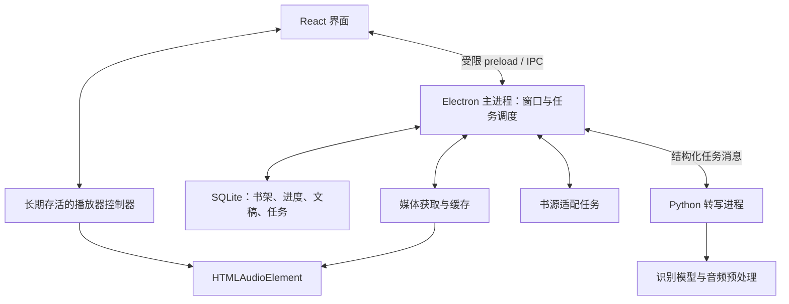

# 架构设计

0.20 长文稿优化补充：正式稿按 `(id, revision)` 条件读取，未变返回版本而非正文；播放器通过摘要读取完整 coverage，不取全部句子。renderer 合并同目标的在途读取，通知使旧请求失效后继续复查。Main 仅缓存有界覆盖数据和一个已提交任务快照，读写事务与外部 `data_version` 共同约束缓存；编辑读复用仅限单个 `BEGIN IMMEDIATE`，写入和事务结束清除。真正修订仍完整校验／写库，历史哈希、人工保护及原媒体时间不变，不能据此宣称所有大稿操作已移出主线程。实测与限制见 [UI 与性能优化](UI_PERFORMANCE_OPTIMIZATION.md)。

状态：M2 同步伴读和 M3 应用内自动转写已实现。0.9.0-dev.1 独立预览新增首个在线来源的搜索到缓存播放/转写复用；下一集预处理和缓存清理仍待补齐。默认模型、完整听书质量与主程序发布验收保持待办。

M3 通过 SQLite 队列和受限 IPC 接入独立 Python 进程，提供重叠分块、中文标点、版本化缓存、重启续接和纠错保护；整首歌曲已通过真实应用流程。配置与限制见 [组件说明](ASR_WORKER.md)、[模型评估](M3_EVALUATION.md) 和 [应用验收](M3_APP_VALIDATION.md)。

## 1. 进程与模块

`0.43` 将书架摘要、章节页和播放上下文分开：Main `LibraryStore` 的摘要聚合不物化全库章节，章节页有 100 项硬上限；`getPlaybackContext` 依据同一 canonical 排序返回真实前后邻居和零基目录位置。renderer 的 `player.ts` 不再持有整个 `Book[]`，普通变更与媒体完成事件不附带完整 `AppState`；旧 `getState` 独立保留。电子书摘要先在 SQLite 移除章节数组后解析，Reader 仅读目标单本。分页、会话隔离及测量限制见 [大书架性能](LIBRARY_PERFORMANCE.md)。

在线媒体在 `0.38` 增加明确的临时身份：`OnlineMedia` 仍拥有单 GET、完整哈希与原子缓存注册，`ProgressiveMedia` 只通过独立只读句柄提供已落盘字节的本机 Range，不解析远端地址或伪造哈希。`PendingOnlineProgressStore` 在 schema 18 保存会话限定的前缀证明和位置，完整提交时同事务移交；活动 lease 不持久化。schema 上限由 `database-schema.ts` 供打开数据库与备份恢复共用。renderer 的来源更新只替换已认证身份，保留同一 audio 元素；ASR、映射及书签只接受完整哈希。详细边界见 [在线首播](PROGRESSIVE_PLAYBACK.md)。



- **renderer**：React 页面、阅读排版和播放器控制器。媒体实例放在不随路由卸载的位置，界面隐藏后仍可播放。
- **main**：窗口、托盘、文件选择、应用生命周期、任务调度和本地数据接口。仅执行轻量协调，不同步运行识别模型或大文件处理。
- **preload**：通过 contextBridge 暴露少量明确方法，不透传任意 IPC 通道、文件操作或 shell 执行。
- **shared**：IPC 消息、数据结构、错误码与时间单位的 TypeScript 定义；运行时另做参数校验。
- **任务层**：耗时的本地扫描、哈希和网络任务可进入 worker/utility process；Python 与 FFmpeg 通过子进程运行。Electron utilityProcess 本身用于 Node.js 任务，不直接充当 Python 解释器。

第一版只需要本地进程通信，不要求部署 FastAPI 或其他网络后端。第三方登录页面使用隔离窗口和会话，不与应用 UI 共享特权桥接。

## 2. 播放与同步

播放器的媒体时间是唯一同步基准。定时器或动画帧只负责刷新显示，不通过累计现实时间推算音频位置。

1. 读取 HTMLAudioElement.currentTime 并转换为毫秒。
2. 在已排序的时间片段中查找 `startMs <= positionMs < endMs` 的句子。
3. 只在当前句变化时更新高亮；进度条可使用独立、节流后的更新频率。
4. 点击句子时将媒体时间设为 startMs；播放跳转完成后重新读取真实位置。
5. 静音空隙、尚未转写区间和错误片段不假装存在精确文字对应。

切段识别的局部时间必须加回原始音频偏移。跳过片头/片尾、广告折叠和文字纠错不整体移动原媒体时间轴。

手动滚动暂停自动跟随；“回到当前播放位置”恢复跟随。页面切换、组件重渲染和主题变化不重建媒体实例。托盘隐藏保持承载播放的进程；显式退出保存进度并停止后台任务。

## 3. 媒体获取

- 本地文件：使用受控协议或媒体服务读取，经路径检查后提供媒体字节，验证 Range、206、Content-Range、Content-Length 与错误响应。
- 在线来源：SourceAdapter 返回音频定位信息，媒体层处理登录会话、必要请求头、缓存及地址刷新。
- 不把长音频整段编码为 base64 经 IPC 传递；传递受控资源 ID、文件路径引用或媒体 URL。
- 对实际 MP3/M4A/M4B 编码、长文件 seek、倍速与音调保持分别测试。只有实际不满足需求时再评估转码或替换播放器内核。

## 4. 核心数据

| 实体                  | 关键字段                                                              | 约束                           |
| --------------------- | --------------------------------------------------------------------- | ------------------------------ |
| Book                  | id、title、author、narrator、sourceId                                 | 不以书名作为唯一身份           |
| Episode               | id、bookId、order、title、mediaAssetId                                | 集序独立于小说章号             |
| MediaAsset            | id、contentHash、durationMs、locator、version                         | 音频版本变化使旧文稿失效       |
| PlaybackProgress      | bookId、episodeId、positionMs、updatedAt                              | 同时保存章节身份与媒体时间     |
| Transcript            | id、mediaAssetId、engine、modelVersion、configHash、revision          | 可追溯生成来源和用户修改       |
| TranscriptSegment     | id、transcriptId、startMs、endMs、text、status                        | 时间单位为毫秒；允许未识别片段 |
| TranscriptionJob      | id、assetId、status、attempt、progress、error、checkpoint             | 支持取消、重试及重启恢复       |
| Bookmark              | id、episodeId、positionMs、note                                       | 绑定具体音频位置               |
| TextAlignment（后续） | assetId、audioStartMs、audioEndMs、textVersion、textRange、confidence | 多对多映射，保留人工校正       |

音频内容哈希是最终版本依据；文件大小和修改时间可用于快速检查，但不能单独证明音频内容一致。在线临时 URL 变化不自动代表内容变更，须经媒体层核实。

数据库负责元数据、任务及文稿索引；音频、模型和大缓存放在文件系统，数据库记录引用。数据库迁移需要版本号，主程序统一负责数据写入；Python 不直接竞争写入主数据库。

## 5. 转写进程协议（M3 组件已实现）

通过 stdin/stdout 上的 JSON Lines 通信；stdout 仅承载协议消息，日志写 stderr。使用子进程参数数组启动，不拼接 shell 命令。

`asr_worker.py` 接收带 UUID jobId、attempt、audioPath、audioHash 与原媒体 range 的 submit/cancel。引擎、设备和组件路径由 Node 启动参数固定；运行任务不下载模型。progress 报告处理阶段，partial 发送可替换前缀的完整文稿，result/canceled/error 为终态。字段与完整示例见 [协议](ASR_WORKER.md#进程与协议)。

- Node 控制器过滤旧 jobId/attempt 和已取消任务的迟到消息，使用 M2 校验器检查文稿与原偏移；协议错误或异常退出可保留上层已接受的前缀。
- Python 主线程负责解码和模型操作，单独线程读取协议。取消超过宽限期时，Node 停止自己拥有的进程树；取消接受消息本身不等于任务终止。
- 已完成分块按音频与完整处理配置保存，重试/重启复用并重新校验；原始输出与边界冲突保留。长期进程复用已加载模型，完全命中时不加载模型。
- 上层 SQLite 队列管理状态恢复、幂等文稿写入、界面更新与用户修改保护；Python 不写主数据库。当前串行 FIFO，优先级调度与组件分发仍为后续工作。

## 6. 当前目录与后续扩展

```text
src/
  main/                 # 生命周期、托盘、IPC、SQLite、导入哈希、静态与媒体协议
  preload/              # 受限桥接
  renderer/src/         # React 书架/目录、player.ts 单例控制器
  shared/               # 类型与协议
tests/
  unit/                 # 参数/来源校验、资源路径边界、迁移、持久化、文件检查
  desktop/              # 真实 Electron 流程、长音频、托盘、续播与编码验证
  fixtures/             # 可提交的合成 MP3/AAC 与生成脚本
  dev/                  # electron-vite 开发启动与正常退出
docs/
```

用户数据采用 Electron 的应用数据路径，缓存与模型分别使用独立子目录。测试夹具与真实音频、用户文稿和模型权重分开。

播放器位于 `renderer/src/player.ts`，阅读与生成控件位于 `TranscriptReader.tsx`、`TranscriptionControls.tsx`；任务协调位于 `main/transcription-queue.ts`，模型与分块处理位于 `python/asr_*.py`。

## 7. M0 已实现的边界

本节记录 M0 的起点；M1 新增边界见下一节。

- `window.desktop` 仅暴露 `getState()`、`selectAudio({ kind: 'audio' })`、`forgetFile({ id })`。主进程核对窗口、顶层 frame、准确页面 URL、参数个数与字段；不接受任意文件路径、SQL 或 IPC 通道。
- 文件路径只来自操作系统对话框。主进程检查真实路径、扩展名、可读性、普通文件与非空大小，向界面返回随机 ID、名称、大小、修改时间与选择时间；扩展名不代表编码已验证。
- 生产页面通过限定 renderer 目录的 `readlisten://app/` 协议加载，设置 CSP，拒绝越界资源、外部导航、新窗口、webview 和权限请求。开发时仅为 Vite/React 热更新放宽当前页面的脚本、样式及 WebSocket 策略。
- preload 编译为单个 CommonJS 文件，兼容启用 sandbox 的渲染进程；没有 Node 集成、原始 `ipcRenderer` 或 shell 接口。
- `node:sqlite` 由主进程持有，schema v1 用 `selected_files` 保存最多 20 条选择记录。迁移带版本号和事务，拒绝新版数据库，写入采用参数化 SQL。关闭时释放连接，重启从数据库读取。
- 同步数据库操作仅用于这批小型元数据；大文件哈希、扫描和转写不得加入界面交互的同步路径。
- 开发与安装版使用不同默认用户数据目录。`RALB_USER_DATA` 为测试/诊断的绝对目录覆盖；`RALB_EXECUTABLE` 仅由桌面测试读取。

## 8. M1 实现

- 文件路径来自原生选择器或已保存的选择记录 ID；renderer 不提交路径。文件夹递归扫描忽略符号链接，异步流式计算 SHA-256，检查哈希前后的大小和修改时间。确认顺序前只保留 15 分钟的主进程草稿；renderer 只能提交完整且不重复的章节 ID 排列。
- schema v2 保留 `selected_files`，增加 `books`、`episodes`、`player_settings`。导入与进度写入使用事务；同一路径重导入保留 ID，同哈希保留进度，哈希变化重置该集时长和进度，消失的章节从书架移除。音频不复制。
- `readlisten://app/media/<episodeId>/<contentHash>` 仅解析已入库资产。协议开启 `stream`，通过 64 KiB 有界文件流提供 GET/HEAD、单段 Range、206 与 416；取消请求关闭文件流。生产 CSP 只允许同源媒体，开发页面额外允许受控协议。协议依据见 [Electron protocol](https://www.electronjs.org/docs/latest/api/protocol)。
- 播放前与每次媒体请求检查真实路径、普通文件、大小和修改时间；变化时要求重导入。内容哈希在导入时计算，每个 Range 请求不重复哈希；无法识别刻意保持相同大小与修改时间的原地替换，此时应主动重新导入。
- 模块级 `PlayerController` 持有唯一 HTMLAudioElement，书架/目录切换不卸载。进度直接读取媒体时间，每 5 秒保存，并在暂停、跳转和切集时补存。异步切集使用序号忽略迟到结果，主进程随机会话 ID 与内容哈希拒绝旧会话覆盖当前进度。
- 显式退出由主进程要求 renderer 暂停并保存，收到确认后关闭数据库；3 秒超时则记录日志并保留最近一次成功进度。关闭按钮隐藏到托盘，关闭 Chromium 后台节流以保持隐藏期间进度保存；渲染进程崩溃后退出并保留最后成功保存位置。
- MP3 与 AAC LC M4A/M4B 已用合成音频验证。M4B 夹具含两个内嵌章节，当前以一集导入并在界面标明限制；独立章节解析留待有需求时接入。

## 9. M2 实现

- `shared/transcript.ts` 定义 JSON v1、运行时校验和二分定位。音频以 SHA-256 绑定；coverage 明确已标注区域。句间停顿、未覆盖和音频末尾均不保留错误的邻句高亮。
- 主进程 `transcript:get/import` 只接受 episodeId 与 audioHash。JSON 路径只来自原生选择器，读取上限 16 MiB，验证 UTF-8、结构、唯一 ID、时间顺序、重叠、时长与覆盖边界；导入前后再次核对资产版本。
- schema v3 的 `transcripts` 以 episodeId/audioHash 唯一保存文稿 JSON 与修订号。重新导入原子替换当前版本；错误或取消不写库。旧音频版本的文稿保留但不显示，书籍删除时级联清理。M3 沿用有界 JSON，增加任务表与完整前缀快照；长篇性能仍需实测。
- `TranscriptReader.tsx` 使用 60 句分页。播放器提供独立媒体时钟订阅，以 requestAnimationFrame 读取 currentTime；订阅快照是句子/空缺状态，避免每一帧重渲染阅读视图。进度保存维持 M1 的节流机制。
- 手动滚轮、触摸、滚动条和阅读区键盘操作暂停跟随；点击句子或返回当前播放位置恢复。ResizeObserver 在跟随状态下处理视口与字号变化，滚动仅作用于文稿阅读区。
- 阅读设置保存于应用本地存储。阅读模式使用可分配高度的布局，播放器占独立空间，最小窗口不覆盖当前句。
- `scripts/verify.ts` 串行运行验证，记录状态、退出码、日志和未完成计划项；明确的系统启动策略拦截单独记为 blocked，不等价于功能通过。

## 10. M3 应用任务与文稿保护

- schema v4 新增 `transcription_jobs`，保存任务 ID、音频哈希、引擎/设备、attempt、配置摘要、状态、完成块和文稿前缀。同一集同一内容最多一个活动任务；Python checkpoint 保存在文件系统，主数据库仍只由主进程写入。
- 队列串行执行，配置相同可复用模型进程；切换配置先关闭旧进程。启动时 `running → queued` 并递增 attempt，`canceling → canceled`；正常退出先持久化续接状态、关闭拥有的 worker/FFmpeg，再关闭数据库。
- 无现有文稿时，快照在事务中同时推进任务和文稿修订。写入检查任务状态、attempt、资产版本、已处理范围和文稿修订，重复快照不产生多余修订。旧任务、旧音频和取消后的迟到输出均不采用。
- 已有文稿时生成稿单独保存供预览。人工导入或纠错关闭任务的自动应用；采用生成稿必须明确操作，并以预期修订号再次检查，避免覆盖其间的新修改。
- 小范围纠错使用有界编辑距离，保留片段 ID、起止时间和 coverage；超范围修改、拆分合并和重新对齐尚未实现。生成中自动更新的文稿暂不编辑，可先取消再纠错。
- renderer 只提交已知资产 ID、内容哈希、任务 ID、修订号与引擎/设备枚举；组件配置路径只能来自原生选择器。只接受五个组件路径和版本号，worker 脚本固定为应用自带文件；安装包在 `resources/asr/` 附带脚本，Python、模型和 FFmpeg 仍为可选外部组件。
- 阅读区更新使用稳定文稿身份，保留手动阅读位置；键盘滚动受控，返回跟随后重算当前句，避免原生平滑滚动继续将当前句移出最小窗口。

## 11. M4 日常收听

- schema v5 新增 `book_listening_settings`（bookId、introMs、outroMs）及 `bookmarks`（episodeId、audioHash、原始位置、备注、创建时间），删除书籍时级联清理。旧版本迁移保留进度、文稿和任务；同一音频位置重复添加返回已有书签，音频变化后旧书签标记过期并禁止跳转。
- 新增五个受限 IPC：读取本书书签、添加、编辑备注、删除及保存本书跳过设置。参数只包含 ID、音频哈希、有界时间和普通文字，不接收路径或脚本。书签每书最多 2,000 条，阅读界面每页 20 条。
- 播放控制器按当前书设置计算原始播放范围。片头只影响打开章节的初始位置，显式书签/点句定位保持原坐标；播放到片尾起点暂停并保存后进入下一集。跳过总时长不小于单集时长时，该集禁用跳过并显示说明。
- 原生 ended 与片尾检测共用一次性完成标记；等待保存期间再次触发不会重复切集。加载、手动暂停或跳转使旧完成动作失效；保存失败保留当前集并显示重试入口。
- 定时为本次运行的播放器状态：1–180 分钟使用绝对截止时间，间隔检查、timeupdate 和 playing 均校验，托盘隐藏及暂停时继续计时；本集结束模式优先于自动下一集。到期清除待加载音频的自动播放意图，迟到 metadata 不会重新播放。重启不恢复定时。
- 主进程仍持久化播放记录；播放器收到成功保存后更新界面中的最近位置，最近播放视图过滤未播放书籍并实时排序。收听工具使用原生 modal dialog，避免在最小阅读窗口长期占用空间。

## 12. M4 缓存、任务与诊断

- `CacheMaintenance` 仅从已选组件读取资源根路径。大小统计不展开链接；已识别的 `jobs/<SHA-256>/` 缓存须验证 manifest、配置与目录名指纹，仅接受程序生成的分块和原子写入临时文件。未知文件、嵌套目录、链接及不匹配的清单保留。
- 清理为“预览 token → 再核对 → 明确确认”，token 五分钟有效且仅使用一次，缓存变化或组件切换后拒绝。清理前逐级检查真实目录和包含关系，逐文件 unlink、最后非递归 rmdir；不递归删除组件根目录、模型或用户数据。
- 队列的维护独占段要求无 queued/running/canceling 任务，关闭空闲 worker 后执行；期间拒绝生成、重试和更换组件。退出等待维护结束。Python 不写主数据库，清理不改文稿、任务历史或播放进度。
- 任务历史由主数据库分页返回，每页 25 项，可过滤活动任务，界面沿用现有取消/重试 IPC。日志只从固定 `logs/app.log` 返回末尾 64 KiB，以普通文本显示。打开位置只接受 data/logs/cache/models 枚举，模型清单只在系统文件管理器中定位，不执行 Python 或任意路径。

## 13. M4 独立组件 v2

- `component.json` v2 使用 python/models/resources/ffmpeg/ffprobe 五个路径和版本号，resources 为只读断句资源；主进程生成用户目录中的 cache/asr，旧 v1 cache 配置继续支持。持久化路径不包含 renderer 提交的任意脚本，worker 始终由应用提供。
- 私有 Python 来自固定摘要的官方嵌入式 ZIP，依赖按评估锁文件从开发环境取文件后随包提供；不复制虚拟环境 launcher、pip 或 source pyvenv.cfg。所有资产有相对路径和 SHA-256 清单，模型路径以清单所在目录解析，整个包可跨盘移动。
- `_pth` 隔离系统 registry、PYTHONHOME/PYTHONPATH 和全局 site-packages；程序以 -B 启动，worker 仅补入固定应用脚本目录。NLTK 从 resources 读取，HF/ModelScope/Numba/Matplotlib 等可写缓存进入用户缓存目录。
- 主窗口不等待组件文件检查。初始化完成通过只读事件更新界面；配置提交后递增版本，迟到的初始化结果不能覆盖用户的新选择。独立性和迁移报告见 [组件包说明](ASR_COMPONENT_BUNDLE.md)。

## 14. M4 异常恢复

- Windows worker 在创建后代前加入匿名 Job Object，非继承句柄由进程持有至退出，KILL_ON_JOB_CLOSE 处理异常退出；普通取消仍等待主进程确认关闭。不能建立保护时组件明确失败，不影响普通播放。
- 运行推理的 Python 进程限制外部网络、保留回环 IPC，FFmpeg/ffprobe 限 file,pipe；准备/下载仍为独立命令。离线策略版本写入任务 configuration，防止混用旧缓存。
- 缓存按空间不足、权限/只读和其他写入失败分类，失败时保留旧块并尽力清理本次临时文件。文件移动单独提示；有效快照无法存储时保留真实存储错误，不误报协议损坏。
- SQLite 错误发生后先检查事务是否仍活动，避免自动回滚后的二次回滚掩盖错误。任务终态也写入失败时在主进程暂存失败状态，暂停启动其他任务，阅读器与任务历史一致显示；恢复空间/权限后重试先补存终态。该暂存不宣称已落盘，重启以最后保存状态恢复。
- 退出时中断状态无法保存也继续关闭 owned worker，再关闭数据库。故障覆盖范围和真实/注入边界见 [M4 验收](M4_VALIDATION.md)。

## 15. M3 片段类型与折叠

- schema v6 的 `transcript_regions` 以 episodeId + audioHash 保存有序、不重叠的原始毫秒范围、类型与独立修订号；不写入或变更 JSON v1 文稿，重生成/纠错不影响范围。删除书籍级联删除；新音频版本不应用旧范围。
- 标注为人工操作，类型限 advertisement/intro/recap；null 仅移除指定范围。更新先校验资产与修订，再在同一 SQLite 事务内裁开相交区间、保留外侧、合并相邻同类型区间；最多 2,000 个，失败不覆盖旧值。主进程只接受已知资产、范围、类型和修订，不接收文本或路径。
- 句子完全包含在单个范围内才允许折叠；部分或混合重叠只显示提示，避免模型重新分句后误藏正文。阅读依旧按原句子每页 60 条，折叠组只汇总本页，展开不渲染全部章节。
- 当前范围与当前句均来自真实媒体时钟，半开区间边界；折叠不触发 seek 或改动播放。没有识别文字的范围在管理菜单中保留，可定位/修改/移除，每页 20 处。详情见 [片段标注](TRANSCRIPT_REGIONS.md)。

## 16. M5 首个在线来源

- `Ting13Adapter` 提供搜索、详情、分页目录和临时地址解析；普通网页脚本只在无 preload/Node/应用 IPC 的隔离 renderer 中加载，独立 Session 处理站点匿名浏览 Cookie。DOM 通过隔离世界返回有界结构，不执行网页全局解密入口。超时、取消及单源失败返回独立错误码。
- `SourceBrowser` 串行化请求，新任务取消并等待前次清理，过期返回不更新界面。在线浏览与媒体获取使用各自加载器，浏览搜索不会取消正在缓存的播放请求；关闭应用分别等待清理。
- schema v7 的 `online_books` 和 `online_episodes` 保存源书籍/分集身份与稳定应用 UUID。远端目录行独立于必须有真实大小/哈希的本地 `episodes`；缓存成功才创建本地音频记录。分页书架标记未完整目录，跨书/重复/变序拒绝事务提交。
- `OnlineMedia` 仅接收已入库分集 UUID，从适配器获取临时 URL，以 HTTPS 主机白名单、Referer、手动重定向检查和一次失效重解获取完整 MP3。流式临时写入受 120 秒、256 MiB 和预留空间限制，完整校验与同步后原子改名、入库；失败回收本次临时文件，URL 不进入数据库身份。
- 内容 SHA-256 进入既有媒体 Range 协议、播放会话和转写队列；缓存命中复核文件/摘要并直接复用。相同内容保持进度，不同内容重置进度/时长而保留原哈希的文稿、书签与范围。活动旧版本转写在打开章节时协调取消，迟到任务不能覆盖新音频。
- 获取请求以独立 request UUID 区分，同一集连续打开仍取消、等待和替换；播放器 generation 阻止旧请求/metadata 接管新集。前台打开可取消并等待后台预备；目录边界从新适配器重新获取分页，验证旧身份、顺序与完整性后事务提交，不保存短期游标。
- schema v8 增加 `cache_available`、`source_media_files`、单书预处理设置和任务 `background`。512 MiB 配额与清理仅回收登记且复核的普通文件；当前播放、媒体获取、任务及本地导入引用受到保护，链接和未知文件保留。清理删除资产登记并标记缓存不可用，保留版本文稿、书签、范围和进度。预览令牌绑定文件元数据和保护集合。
- 相邻一集缓存/转写默认关闭，由单书设置启用。前台任务排在后台前；活跃后台 worker 先持久化检查点并增加 attempt，再取消，迟到输出忽略。清理期间阻止新任务提交，已有任务文件仍受保护。后台转写前以隔离世界的独立 Chromium metadata 元素测量实际播放时长，避免 FFprobe 与播放器的 MP3 时长差异。见 [实际书源验收](ONLINE_SOURCE_TING13.md)。

## 17. M6 原文索引与映射

- 原生选择器限定 TXT/EPUB；Node worker 有界读取、解码、解析和检索。EPUB 仅内存解压/校验，XML 文字进入结构化段落，不载入网页或远程资源。worker 可取消，退出后拒绝新任务。
- schema v9 的 `original_documents` 按 SHA-256/解析版本去重，JSON 中的章节、段落、句子序号构成不可变索引；`book_originals` 绑定整本音频书。`original_alignments` 按集 UUID、音频哈希、原文版本保存转写身份/修订及人工修订，不改 `transcripts`。
- 三元组召回有界原文窗口，版本 2 允许唯一精确相邻转写上下文帮助短句定位。相似度与规则置信条件独立于模型概率；歧义、冲突及插话保持空缺。人工范围与同步时间提交前校验资产、修订、音频时长及相邻片段边界；同一转写快照下重新匹配/规则升级保留人工选择与留空。
- renderer 按 60 句请求原文、按 20 段校正，媒体时间驱动已选映射高亮。未映射位置没有虚构覆盖，点句保留播放状态；原文变化与转写修订使旧结果失效。实际证据与限制见 [原文验收](ORIGINAL_TEXT.md)。
- `original:find` 在受限 Node worker 内搜索当前不可变原文版本，归一化文字并保留自然段/章节分隔；返回总数和每页 20 个句范围，提交前复核音频与原文版本。定位仅调整原文阅读页和焦点，不改变媒体位置。
- `transcript:export-subtitles` 只接收音频/文稿及可选原文匹配身份与修订。保存路径来自原生保存框，在框前后复核快照；按原毫秒输出 SRT/VTT，原文仅输出已选映射，32 MiB 上限。目标目录内独占创建临时文件、同步并改名，失败清理本次临时文件。生成预览需先采用。实际检查见 [搜索与字幕](READING_TOOLS.md)。
- 匹配规则 3 在归一化全文中校验精确位置，最多保存两个不同句范围和 256 条查询缓存，补入候选列表以免有限召回伪造唯一性；短句上下文须全文唯一。规则版本进入旧映射失效判断，重新匹配保留同一转写快照的人工校正。固定旧/新 worker 与真实三集证据见 [全局歧义检查](ORIGINAL_SEQUENCE.md)。
- 当前规则 4 由 main/worker 的 `original/normalize.ts` 使用固定 OpenCC 离线字典做繁简检索规范化，renderer 不载入字典；全书歧义保护继续生效。原文 JSON、ASR 文稿、展示及原文字幕不改写。TXT 保持解析版本 2，EPUB 版本 3 跳过纯图片空分区。原文阅读区至少 180 px，用户滚轮、触摸、键盘或表单操作暂停跟随。真实 EPUB2/EPUB3 和单集跨章证据见 [EPUB 验收](ORIGINAL_EPUB.md)。

## 18. 转写稿全文搜索

`TranscriptSearch` 首次展开时在同源 Web Worker 建立当前显示文稿的快照索引，保存规范化全文与非空片段的终点序列。检索跨相邻片段，按源片段范围合并重复结果，每页 20 处，缓存一个查询；没有新增主进程 IPC 或数据库状态。worker 由 Vite 独立构建，沿用现有 CSP 与受控资源协议。

组件按文稿 ID/修订装载，已保存稿与生成预览有独立身份；切换、修订或隐藏阅读界面时回收线程。请求序号与存活标记拒绝旧消息，取消/30 秒超时终止旧线程。结果只调整阅读页、局部展开标注和焦点；命中标记绑定修订，媒体时钟与原文稿不变。实际生命周期、竞态及长文稿验证见[转写稿搜索](TRANSCRIPT_SEARCH.md)。

## 19. 独立电子书正常阅读

schema v10 的 `reading_books` 以原文 UUID 保存句序号和最近阅读时间，不创建音频书或伪造集身份。`ReadingStore` 与 `OriginalStore` 通过事务内的 `storeOriginalDocument` 共用哈希/解析版本去重；访问正文、分页和写位置前必须验证独立书架成员资格，缓存命中也不能跳过检查。移除时只回收没有伴读引用的正文。

`reading:*` IPC 继续验证顶层 renderer 身份、精确参数和有界序号，导入路径来自原生选择器。解析与全文检索复用受限 Node worker，检索完成后再次确认书籍仍存在。`NormalReading` 每页最多展示 60 句，按自然段合并呈现，通过可见句锚点保存/恢复位置；字体和主题独立保存。目录、翻页、全文定位不调用播放器，空播放器仅在正常阅读且没有音频时隐藏。验证见 [正常阅读](NORMAL_READING.md)。

## 20. 来源续读、封面与维护边界

`TextSourceService` 维护来源身份和取消，`TextBookImporter` 调用原文 worker 解析单章，`SourceReadingStore` 在事务中向同一个来源阅读文档追加。schema 17 增加独立扩展表 `source_reading_books`，记录本地文档、来源作品及已下载章节身份／序号；手动 TXT／EPUB 的不可变去重流程不变。来源文档追加会更新 hash，保留旧句序号和本地 ID；正文缓存、自动匹配 worker 及提交快照同时校验 hash，拒绝追加前的过期匹配结果。目录令牌由宿主绑定作品和插件包 hash，不把原站 cursor 直接当作阅读坐标。

`SourceCoverService` 代理按来源授权的栅格图片；`PersistentBookCovers` 仅持久保存已校验候选，按内容 hash 去重并以本地只读协议提供。图片索引与备份复制串行。`PluginMaintenance` 将检查结果及无凭据更新地址保存在独立本机元数据中，更新检查只产生包预览，仍经既有安装事务确认。

`BackupService` 对白名单 SQLite 数据、正文、封面和偏好建立校验清单；原文件、模型、缓存、凭据和执行包不打包。恢复在单实例锁取得后、数据库打开前应用，先保留原目录；本机已有插件及其维护记录单独保留。渲染入口在 App 首次挂载前应用白名单偏好并确认。`GeneratedStorageService` 只管理新建回执目录，备份回滚与历史未知内容不进入清理范围。协议和故障边界见 [备份与存储](BACKUP_STORAGE.md)。
