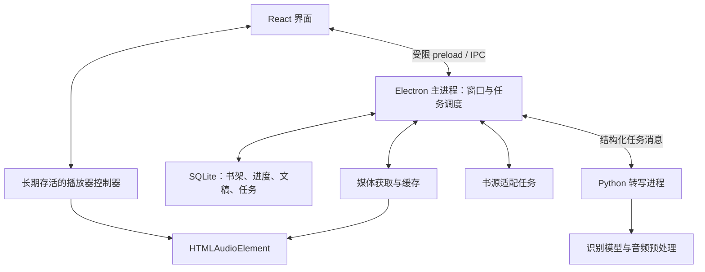

# 架构设计

状态：开发前设计，后续以实现和测试结果修订。

## 1. 进程与模块



- **renderer**：React 页面、阅读排版和播放器控制器。媒体实例放在不随路由卸载的位置，界面隐藏后仍可播放。
- **main**：窗口、托盘、文件选择、应用生命周期、任务调度和本地数据接口。仅执行轻量协调，不同步运行识别模型或大文件处理。
- **preload**：通过 contextBridge 暴露少量明确方法，不透传任意 IPC 通道、文件操作或 shell 执行。
- **shared**：IPC 消息、数据结构、错误码与时间单位的 TypeScript 定义；运行时另做参数校验。
- **任务层**：耗时的本地扫描、哈希和网络任务可进入 worker/utility process；Python 与 FFmpeg 通过子进程运行。Electron utilityProcess 本身用于 Node.js 任务，不直接充当 Python 解释器。

第一版只需要本地进程通信，不要求部署 FastAPI 或其他网络后端。第三方登录页面使用隔离窗口和会话，不与应用 UI 共享特权桥接。

## 2. 播放与同步

播放器的媒体时间是唯一同步基准。定时器或动画帧只负责刷新显示，不通过累计现实时间推算音频位置。

1. 读取 HTMLAudioElement.currentTime 并转换为毫秒。
2. 在已排序的时间片段中查找 `startMs <= positionMs < endMs` 的句子。
3. 只在当前句变化时更新高亮；进度条可使用独立、节流后的更新频率。
4. 点击句子时将媒体时间设为 startMs；播放跳转完成后重新读取真实位置。
5. 静音空隙、尚未转写区间和错误片段不假装存在精确文字对应。

切段识别的局部时间必须加回原始音频偏移。跳过片头/片尾、广告折叠和文字纠错不整体移动原媒体时间轴。

手动滚动暂停自动跟随；“回到当前播放位置”恢复跟随。页面切换、组件重渲染和主题变化不重建媒体实例。托盘隐藏保持承载播放的进程；显式退出保存进度并停止后台任务。

## 3. 媒体获取

- 本地文件：使用受控协议或媒体服务读取，经路径检查后提供媒体字节，验证 Range、206、Content-Range、Content-Length 与错误响应。
- 在线来源：SourceAdapter 返回音频定位信息，媒体层处理登录会话、必要请求头、缓存及地址刷新。
- 不把长音频整段编码为 base64 经 IPC 传递；传递受控资源 ID、文件路径引用或媒体 URL。
- 对实际 MP3/M4A/M4B 编码、长文件 seek、倍速与音调保持分别测试。只有实际不满足需求时再评估转码或替换播放器内核。

## 4. 核心数据

| 实体 | 关键字段 | 约束 |
| --- | --- | --- |
| Book | id、title、author、narrator、sourceId | 不以书名作为唯一身份 |
| Episode | id、bookId、order、title、mediaAssetId | 集序独立于小说章号 |
| MediaAsset | id、contentHash、durationMs、locator、version | 音频版本变化使旧文稿失效 |
| PlaybackProgress | bookId、episodeId、positionMs、updatedAt | 同时保存章节身份与媒体时间 |
| Transcript | id、mediaAssetId、engine、modelVersion、configHash、revision | 可追溯生成来源和用户修改 |
| TranscriptSegment | id、transcriptId、startMs、endMs、text、status | 时间单位为毫秒；允许未识别片段 |
| TranscriptionJob | id、assetId、status、attempt、progress、error、checkpoint | 支持取消、重试及重启恢复 |
| Bookmark | id、episodeId、positionMs、note | 绑定具体音频位置 |
| TextAlignment（后续） | assetId、audioStartMs、audioEndMs、textVersion、textRange、confidence | 多对多映射，保留人工校正 |

音频内容哈希是最终版本依据；文件大小和修改时间可用于快速检查，但不能单独证明音频内容一致。在线临时 URL 变化不自动代表内容变更，须经媒体层核实。

数据库负责元数据、任务及文稿索引；音频、模型和大缓存放在文件系统，数据库记录引用。数据库迁移需要版本号，主程序统一负责数据写入；Python 不直接竞争写入主数据库。

## 5. 转写进程协议（建议）

通过 stdin/stdout 上的 JSON Lines 通信；stdout 仅承载协议消息，日志写 stderr。使用子进程参数数组启动，不拼接 shell 命令。

```json
{"protocolVersion":1,"type":"submit","jobId":"job-1","assetId":"asset-1","audioPath":"C:/example/chapter.mp3","engine":"candidate","options":{}}
{"protocolVersion":1,"type":"progress","jobId":"job-1","processedUntilMs":30000}
{"protocolVersion":1,"type":"segments","jobId":"job-1","batchId":"batch-1","segments":[{"id":"s1","startMs":1200,"endMs":4800,"text":"示例文字"}]}
{"protocolVersion":1,"type":"cancel","jobId":"job-1"}
```

- 成功、失败、取消分别返回终态；取消请求本身不等于任务已取消。
- 提交、片段批次与重试具备稳定 ID，主程序对重复结果幂等处理。
- 每次尝试携带 attempt/version，丢弃已取消或旧尝试的迟到结果。
- 进程异常退出时将运行任务标记为可恢复，保留已完成片段。
- 长期运行的转写进程可复用已加载模型；优先级变化和资源不足时允许释放模型。
- 不自动下载所有候选模型；模型选择与分发在 M3/M4 实测后确定。

## 6. 建议目录（尚未创建应用骨架）

```text
src/
  main/                 # 桌面生命周期、IPC、数据库、任务与媒体服务
  preload/              # 受限桥接
  renderer/src/
    features/library/   # 书架和导入
    features/player/    # 播放控制器与 UI
    features/transcript/# 伴读、编辑、跟随
    features/settings/
  shared/               # 类型与协议
python/
  transcription/        # 独立转写进程和引擎适配
tests/
  fixtures/             # 小型合成或可分发测试样本
docs/
```

用户数据采用 Electron 的应用数据路径，缓存使用独立子目录；模型目录可配置。测试夹具与真实音频、用户文稿和模型权重分开。
